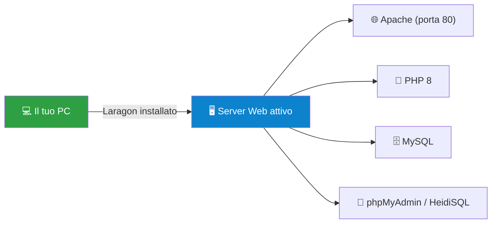
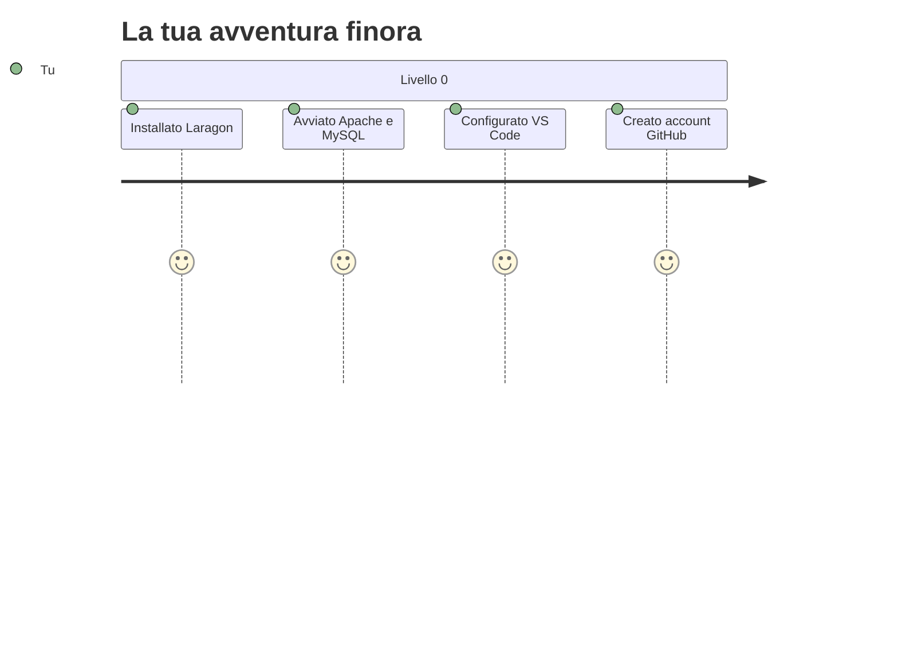

# 🛠️ Livello 0: Guida all'Installazione — Prepara il tuo Arsenal

> Benvenutə al Livello 0! Qui non si scrive ancora codice: **si prepara il terreno di gioca**. È come quando installi un nuovo videogioco: prima scarichi, poi configuri, poi finalmente giochi. In 20 minuti avrai un ambiente da vero sviluppatore professionista.

---

## 📦 Cosa dobbiamo installare

| # | Software | A cosa serve | Link ufficiale |
|---|----------|--------------|----------------|
| 1 | **Laragon** | Il nostro "pacchetto completo": server Apache, PHP, MySQL, tutto pronto in un click | [laragon.org](https://laragon.org) |
| 2 | **Visual Studio Code** | Il nostro editor di codice: leggero, gratis, potentissimo | [code.visualstudio.com](https://code.visualstudio.com) |
| 3 | **Git** | Il sistema che tiene traccia di ogni modifica al codice (come il "salvataggio" dei videogiochi, ma migliore) | [git-scm.com](https://git-scm.com) |
| 4 | **GitHub Desktop** *(opzionale)* | Se preferisci bottoni e menù a riga di comando | [desktop.github.com](https://desktop.github.com) |

> [!NOTE]
> Con **Laragon Full** installi in un colpo solo: Apache (il cameriere del web 🍽️), PHP (il cuoco 👨‍🍳), MySQL (il magazziniere 🗄️) e persino HeidiSQL per gestire il database. Un installer, zero dolori.

---

## 🪟 Passo 1: Installare Laragon

1. Vai su [laragon.org](https://laragon.org) → **Download**.
2. Scegli la versione **Full** (~170 MB): contiene già PHP 8+ e MySQL.
3. Installa come qualsiasi programma Windows (doppio click → Avanti → Avanti → Fine).
4. Avvia Laragon. Vedrai un pannello scuro con 4 servizi: **Apache**, **MySQL**, **PHP**, **Node.js**.
5. Premi il pulsante **Start All**. Se Apache e MySQL diventano verdi 🟢, **hai appena trasformato il tuo PC in un server web**. 🎉



> [!TIP]
> Laragon crea la cartella `C:\laragon\www\`. **Questa è la tua casa per tutto il corso.** Ogni cartella dentro `www` diventerà un sito web con il suo URL!

---

## 📝 Passo 2: Visual Studio Code + Estensioni

1. Scarica VS Code dal [sito ufficiale](https://code.visualstudio.com) e installalo.
2. Apri VS Code → vai su **Estensioni** (l'icona dei quadratini, o `Ctrl+Shift+X`).
3. Installa queste estensioni (cercale nella barra di ricerca):

| Estensione | Autore | A cosa serve |
|------------|--------|--------------|
| **PHP Intelephense** | Ben Mewburn | Autocompletamento magico per PHP ✨ |
| **PHP Debug** | Xdebug | Per fermare il codice a metà e vedere cosa succede 🐞 |
| **Prettier** | Prettier | Formatta il codice in automatico, sempre ordinato 🧹 |
| **Live Server** | Ritwick Dey | Anteprima live delle pagine HTML 🔄 |

> [!WARNING]
> Esiste un'estensione chiamata "PHP" di Felix Becker: **non serve** se hai Intelephense. Troppi assistenti in cucina roviano la pasta. 🍝

---

## 🐙 Passo 3: Git e GitHub

1. Installa [Git](https://git-scm.com) (tutti i default vanno benissimo).
2. Crea un account su [github.com](https://github.com) se non ce l'hai.
3. Apri il terminale (o Git Bash) e presentati a Git, così firmerà i tuoi "salvataggi":

```bash
git config --global user.name "IlTuoNome"
git config --global user.email "latuaemail@scuola.it"
```

4. *(Opzionale ma consigliato)* Installa GitHub Desktop per gestire tutto con un'interfaccia grafica.

---

## ✅ Verifica finale: il Test del "Ciao Mondo"

Apri il terminale e digita:

```bash
php -v
```

Se vedi qualcosa tipo `PHP 8.2.x ...`, **livello completato!** Se invece vedi "comando non riconosciuto", riavvia il PC e riprova (Windows a volte ha bisogno di un riavvio per "digie rire" le nuove variabili d'ambiente). 😴



---

## 🎯 Missione Finale del Livello 0

> **"Primo Sangue"** 🩸

1. Apri `C:\laragon\www\` con VS Code (`File → Apri cartella`).
2. Crea una cartella chiamata `prove`.
3. Dentro `prove`, crea un file `index.php` con questo contenuto:

```php
<?php
  echo "🎉 Il mio PC è ufficialmente un SERVER!";
?>
```

4. Con Laragon avviato, apri il browser e vai su: `http://localhost/prove`
5. **Se vedi la scritta con l'emoji, hai completato il livello.** Fatti un selfie con la schermata e postalo nella Pull Request. 📸

> [!NOTE]
> Se qualcosa va storto: *calma*. Riavvia Laragon, controlla che i servizi siano verdi, e ricontrolla il percorso del file. Il 99% dei problemi è una lettera maiuscola sbagliata nel nome della cartella. I computer sono pignoli, ma sono anche coerenti: sbaglieranno sempre allo stesso modo, e tu imparerai a leggerli. 🔍
