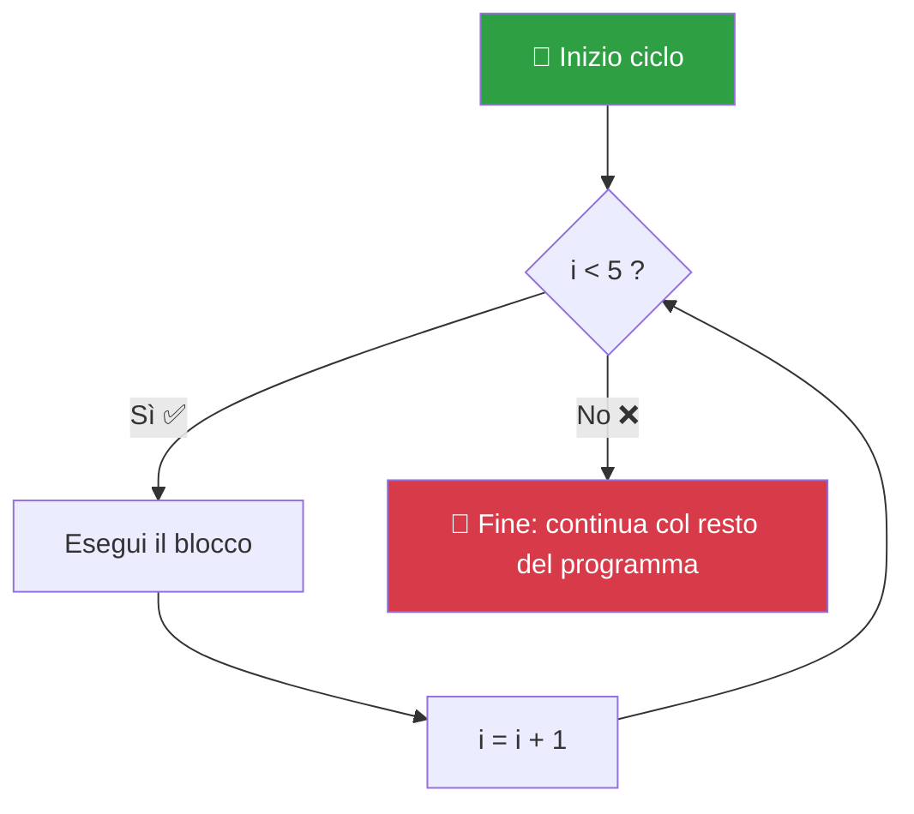
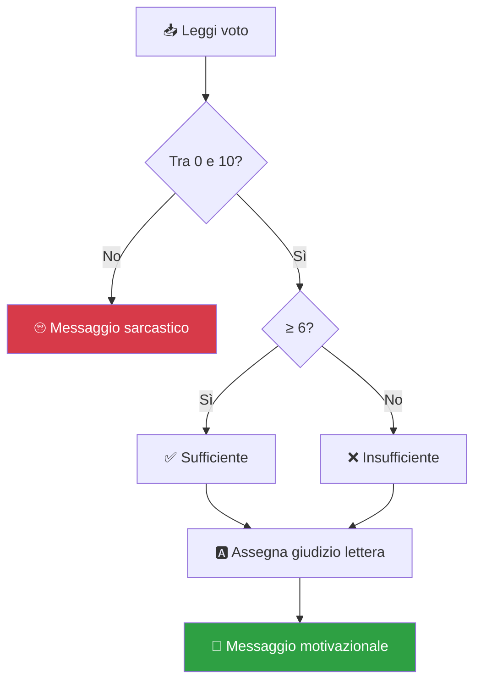

# ⚡ Modulo 01: Fondamenti di PHP — Il Linguaggio che Muove il Web

> Sai quando ordini una pizza dall'app e dopo 30 minuti suona il campanello? 🍕 Qualcuno, in cucina, ha letto il tuo ordine, ha preparato la pizza, l'ha messa nella scatola e l'ha consegnata. **PHP è quel cuoco di cucina**: lavora *dietro le quinte* del sito, prepara la pagina su misura per te e te la consegna nel browser. Tu non lo vedi mai, ma senza di lui... niente pizza. E niente Facebook, niente Wikipedia, niente niente (quasi).

---

## 🧠 Concetti chiave

- PHP = **P**HP **H**ypertext **P**reprocessor (sì, è un acronimo ricorsivo: i programmatori amano le battute 😅)
- È un linguaggio **server-side**: gira sul server, non nel tuo browser (a differenza di JavaScript)
- Ogni file PHP inizia con `<?php` e finisce con `?>`
- **Punto e virgola `;` = respiro.** Dimenticalo e PHP si lamenta. È il suo modo di dire "e poi? e poi?"

---

## 🍱 Le Variabili: le scatole etichettate

Una variabile è una scatola con un'etichetta. Metti dentro un valore, e quando ti serve lo riprendi. In PHP le scatole iniziano sempre con `$`.

```php
<?php
$nome = "Sofia";            // scatola etichettata "nome" con dentro testo
$eta = 17;                  // scatola con un numero intero
$altezza = 1.72;            // numero decimale (il punto, non la virgola!)
$is_studente = true;        // booleano: vero/falso
$materie = ["Info", "Mat"]; // array: una scatola con scomparti!
?>
```

| Tipo | Esempio | Spiegazione |
|------|---------|-------------|
| `string` | `"Ciao"` | Testo, sempre tra virgolette |
| `int` | `42` | Numeri interi |
| `float` | `3.14` | Numeri con la virgola |
| `bool` | `true` / `false` | Interruttore acceso/spento |
| `array` | `["a", "b"]` | Liste di valori |

> [!TIP]
> PHP è "debolmente tipizzato": è gentile e converte i tipi al posto tuo quando può. Ma non abusarne: essere chiari sul tipo dei dati è segno di rispetto verso chi leggerà il tuo codice (e quel qualcuno, tra 3 mesi, sei tu).

---

## 🔀 Condizioni: il codice che prende decisioni

Come al distributore automatico: **se** inserisci 1€ **e** premi il tasto, esce la merendina. Altrimenti ti guarda male.

```php
<?php
$voto = 8;

if ($voto >= 6) {
    echo "🎉 Promosso!";
} elseif ($voto == 6) {
    echo "😅 Raspato per un pelo...";
} else {
    echo "📚 Rivediamo quei paragrafi...";
}
?>
```

### Operatore ternario: il colpo di scena in una riga

```php
$messaggio = ($eta >= 18) ? "Puoi votare 🗳️" : "Ancora no, piccolo padawan 🧒";
```

---

## 🔁 Cicli: lavoro ripetuto senza impazzire

Stampare "Ciao" 100 volte a mano? Mai più. I cicli esistono per questo.


```php
<?php
// Ciclo for: "ripeti 5 volte"
for ($i = 0; $i < 5; $i++) {
    echo "Giro numero $i <br>";
}

// Ciclo foreach: "per ogni elemento di questa lista"
$materie = ["Informatica", "Matematica", "Storia"];
foreach ($materie as $materia) {
    echo "Oggi studio: $materia <br>";
}
?>
```

---

## 🍳 Le Funzioni: ricette pronte all'uso

Una funzione è una ricetta: la scrivi una volta, e poi la richiami ogni volta che ti serve. Con `return` la ricetta **restituisce** il piatto finito.

```php
<?php
/**
 * Calcola la media di due voti.
 * @param float $v1 Primo voto
 * @param float $v2 Secondo voto
 * @return float La media aritmetica
 */
function mediaVoti(float $v1, float $v2): float {
    return ($v1 + $v2) / 2;
}

$media = mediaVoti(7.5, 9);
echo "La tua media è: $media";  // 8.25
?>
```

> [!WARNING]
> **`echo` ≠ `return`!** `echo` *stampa* sullo schermo (come urlare il risultato dalla finestra), `return` *restituisce* il valore (come consegnarlo in mano). Consegnare in mano è molto più utile, perché chi riceve il valore può usarlo per altri calcoli.

---

## 🎮 La Missione Finale: *"Giudice Supremo"*

Apri `esercizi.php` in questa cartella e completa le 5 missioni. Sei pronto per diventare il giudice supremo del registro elettronico!

**Brief della missione:**
> L'utente inserisce il proprio voto (da 0 a 10). Il tuo programma deve:
> 1. Verificare che il voto sia valido (0–10), altrimenti dire "*Inserisci un voto sensato, genio* 🙄"
> 2. Dire se il voto è **sufficiente** (≥6) o no
> 3. Assegnare un giudizio in lettere: 9-10 → A, 7-8 → B, 6 → C, <6 → F
> 4. Stampare un messaggio motivazionale diverso per ogni fascia
> 5. 🔥 **Bonus livello difficile:** invece di un solo voto, accetta una lista di voti (array) e stampa la media + il giudizio della media



> [!NOTE]
> **Come consegnare:** risolvi le missioni, committa con `git commit -m "modulo-01: missione giudice supremo completata"` e apri una Pull Request. Se sei bloccato da più di 20 minuti, apri una Issue: il docente non morde (promesso). 🦈

➡️ **Pronto per far girare tutto sul server?** Vai al [Modulo 02: Laragon](../02-laragon-ambiente-locale/README.md)
