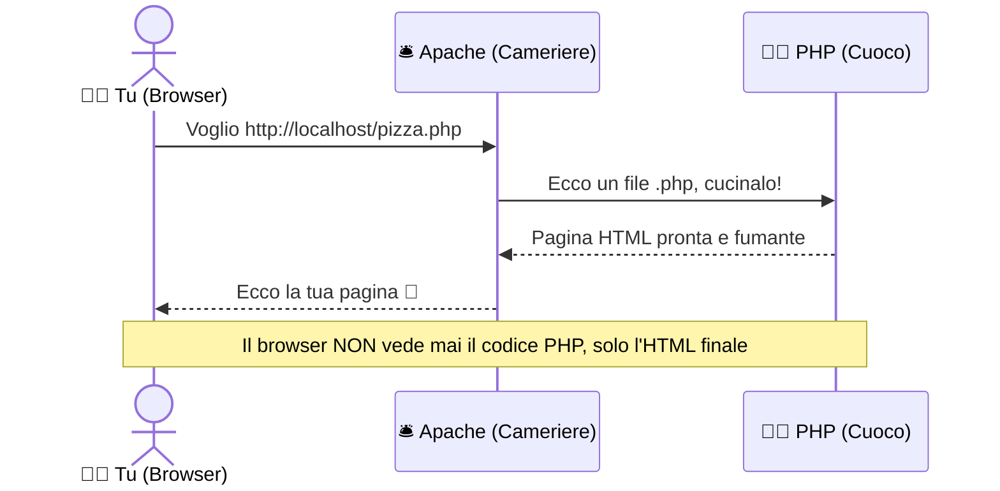
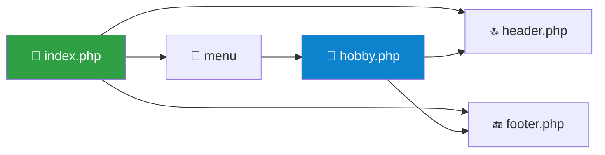

# 🌐 Modulo 02: Laragon e l'Ambiente Locale — Il Tuo Server Personale

> Hai presente quando apri un ristorante? 🍽️ Prima di far entrare i clienti ti servono: una **cucina** (dove si cucina), un **cameriere** (che porta i piatti ai tavoli) e un **menù** (cosa si può ordinare). Un sito web funziona uguale. Oggi apriamo il **nostro ristorante privato**, sul tuo PC, dove l'unico cliente sei tu. Zero costi, zero rischi, zero figuracce pubbliche. 😎

---

## 🧠 Concetti chiave

- **Server web** = il cameriere: riceve la richiesta del browser e consegna la pagina.
- **Apache** = un software server web molto diffuso (quello che useremo).
- **PHP** = il cuoco: prepara la pagina al volo.
- **MySQL** = la dispensa: dove si conservano i dati (la useremo nel Modulo 04).
- **localhost** = "questo computer". Quando scrivi `localhost` nel browser, il PC parla con se stesso. (Sì, è un po' filosofico 🧘)
- **Laragon** = il kit tutto-in-uno che installa e avvia **Apache + PHP + MySQL** con un click, senza perdere ore in configurazioni.

> [!NOTE]
> Se hai seguito la [Guida all'installazione](../00-guida-installazione/README.md), Laragon è già sul tuo PC. Se non l'hai fatto, torna lì: non si può aprire un ristorante senza cucina. 🔪

---

## 🍕 L'analogia: cosa succede quando apri una pagina PHP



> [!IMPORTANT]
> Il browser **non riceve mai il codice PHP**, solo il risultato. Per questo un file `.php` aperto con doppio click (`file:///...`) **non funziona**: serve passare dal server!

---

## 🚀 Avviare Laragon (passo dopo passo)

1. Apri **Laragon**.
2. Clicca su **▶️ Avvia tutto** (*Start All*). Si avviano Apache e MySQL.
3. Controlla che nella finestra compaiano Apache e MySQL **in esecuzione**.
4. Apri il browser e vai su `http://localhost`: se vedi la pagina di benvenuto di Laragon, hai un server! 🎉

| Pulsante | A cosa serve |
|----------|--------------|
| ▶️ **Avvia tutto** | Accende Apache + MySQL |
| ⏹️ **Arresta** | Spegne tutto (fallo a fine lezione) |
| 🌐 **Web** | Apre il sito nel browser |
| 🗄️ **Database** | Apre HeidiSQL per gestire MySQL |
| 💻 **Terminale** | Apre un terminale già configurato con PHP |
| 📁 **Root** | Apre la cartella `www` dei tuoi siti |

> [!NOTE]
> I nomi dei pulsanti possono variare un po' tra le versioni di Laragon: se non trovi quello giusto, passa il mouse sulle icone.

---

## 📁 La cartella magica `www`

Tutto quello che vuoi pubblicare sul tuo server locale va nella cartella **`www`** di Laragon (di solito `C:\laragon\www`).

```text
C:\laragon\www\
├── index.php            →  http://localhost/
├── ciao\
│   └── index.php        →  http://localhost/ciao/
└── quinte-2627\         →  (la tua repo clonata!)
    └── 02-laragon-ambiente-locale\
        └── esercizi.php →  http://localhost/quinte-2627/02-laragon-ambiente-locale/esercizi.php
```

> [!TIP]
> **Consiglio d'oro:** clona questa repository **direttamente dentro `www`**. Così ogni file PHP è subito raggiungibile dal browser, senza copiare niente in giro.

```bash
cd C:\laragon\www
git clone https://github.com/TUO-USERNAME/quinte-2627.git
```

---

## ✨ Il superpotere: i Virtual Host automatici

Scrivere `localhost/quinte-2627/02-laragon.../` è lunghino, vero? Laragon ha un trucco: ogni cartella dentro `www` può avere un **indirizzo tutto suo**.

Se crei la cartella `www\mio-sito`, Laragon (con l'opzione *Auto Virtual Hosts* attiva) ti regala l'indirizzo:

```text
http://mio-sito.test
```

> [!NOTE]
> Se l'indirizzo `.test` non funziona subito, prova a ricaricare Apache dal menu di Laragon oppure riavvia Laragon (a volte servono i permessi di amministratore per aggiornare il file `hosts`). Il `.test` è un dominio riservato ai test: non esisterà mai su internet vero. 🔒

---

## 💻 Il tuo primo file PHP "vivo"

Crea `www\ciao\index.php` e scrivi:

```php
<?php
// Variabile con il tuo nome
$nome = "Sofia";

// date() restituisce data/ora dal SERVER, non scritta a mano!
$oggi = date("d/m/Y H:i:s");
?>
<!DOCTYPE html>
<html lang="it">
<head>
    <meta charset="UTF-8">
    <title>Il mio primo sito live 🚀</title>
</head>
<body>
    <!-- Qui PHP "stampa" dentro l'HTML con <?= ... ?> -->
    <h1>Ciao <?= $nome ?>! 👋</h1>
    <p>Sul server sono le: <strong><?= $oggi ?></strong></p>
</body>
</html>
```

Ricarica la pagina più volte: **l'orario cambia**. Un file HTML normale non potrebbe mai farlo. Questo è il potere di PHP! ⏱️

> [!TIP]
> `<?= $x ?>` è la scorciatoia di `<?php echo $x; ?>`. Perfetta per "infilare" una variabile dentro l'HTML.

---

## 🧩 Dividere per regnare: `include` e `require`

Header e footer uguali su tutte le pagine? Non copiarli: scrivili **una volta** e richiamali.

```php
<?php include 'header.php'; ?>   <!-- se manca: warning, la pagina continua -->
<h2>Contenuto della pagina</h2>
<?php require 'footer.php'; ?>   <!-- se manca: errore fatale, la pagina si ferma -->
```

| Istruzione | File mancante? | Quando usarla |
|------------|----------------|---------------|
| `include` | ⚠️ Warning, si continua | Parti non essenziali |
| `require` | 💥 Errore fatale, si ferma | Parti indispensabili (config, database) |
| `require_once` | 💥 come `require`, ma **una sola volta** | Evita doppi caricamenti |

---

## 🩺 Pronto soccorso: "non funziona!"

| Sintomo | Probabile causa | Cura 💊 |
|---------|-----------------|---------|
| La pagina mostra il codice PHP | File aperto senza server (`file:///`) o estensione `.html` | Usa `http://localhost/...` ed estensione `.php` |
| `localhost` non risponde | Apache spento | Premi **Avvia tutto** |
| Apache non parte | Porta 80 occupata da un altro programma | Cambia la porta di Apache nelle preferenze di Laragon (es. 8080) e usa `localhost:8080` |
| 404 Not Found | Percorso o nome file sbagliato | Controlla maiuscole/minuscole e cartella dentro `www` |
| Pagina bianca | Errore PHP nascosto | Aggiungi `ini_set('display_errors','1'); error_reporting(E_ALL);` |

---

## 🎮 La Missione Finale: *"Il Mio Sito Live"*

Apri `esercizi.php` in questa cartella e completa le missioni. Poi costruisci il tuo mini-sito!

> **Brief della missione:**
>
> 1. Crea una cartella `www\profilo-di-TUONOME` e apri `http://profilo-di-tuonome.test`
> 2. La pagina `index.php` deve mostrare **nome, classe e data di oggi** presi da variabili PHP
> 3. Crea `header.php` e `footer.php` e includili in `index.php`
> 4. Mostra un **saluto diverso in base all'ora** (buongiorno / buon pomeriggio / buonasera)
> 5. 🔥 **Bonus:** crea una seconda pagina `hobby.php` che stampi i tuoi hobby con un `foreach`, e un menu per navigare tra le due pagine



> [!NOTE]
> **Come consegnare:** `git commit -m "modulo-02: sito live completato"` e apri una Pull Request. Blocco totale da più di 20 minuti? Apri una Issue con screenshot dell'errore. 📸

➡️ **Prossima tappa:** [Modulo 03: Form e Input Utente](../03-form-e-input-utente/README.md)
