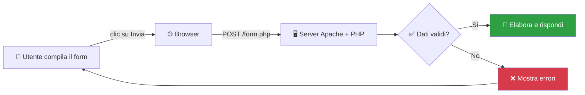
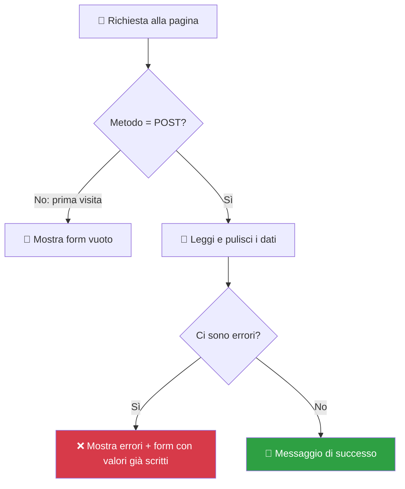

# 📝 Modulo 03: Form e Input Utente — Quando il Sito Inizia a Parlare

> Hai mai compilato il modulo per iscriverti a un social, ordinare su Amazon o mandare un messaggio d'amore a un crush tramite "Contattaci"? 💌 Tutti quei campi sono **form HTML**, e dietro ognuno c'è uno script PHP che legge cosa hai scritto e decide cosa farne. Fino a ieri il nostro sito *parlava soltanto*. Oggi impara anche ad **ascoltare**. 👂

---

## 🧠 Concetti chiave

- Un **form** è il modo con cui l'utente manda dati al server.
- I dati viaggiano con due metodi: **GET** e **POST**.
- PHP li raccoglie in due array speciali (le *superglobali*): `$_GET` e `$_POST`.
- **Regola d'oro del web:** 🚨 *mai fidarsi di quello che arriva dall'utente.* Mai. Nemmeno di tua nonna.

---

## 📮 GET vs POST: cartolina o lettera sigillata?

| | **GET** 🪧 | **POST** ✉️ |
|---|---|---|
| Analogia | Cartolina: tutti possono leggerla | Lettera in busta chiusa |
| Dove viaggiano i dati | Nell'**URL** (`?nome=Sofia&eta=17`) | Nel **corpo** della richiesta |
| Si può salvare nei preferiti? | ✅ Sì | ❌ No |
| Adatto a | Ricerche, filtri, paginazione | Login, registrazioni, invio di dati |
| Superglobale PHP | `$_GET` | `$_POST` |

> [!WARNING]
> **POST non significa "sicuro"!** Nasconde i dati dall'URL, ma non li cifra. Per proteggere password e dati sensibili serve **HTTPS** (e, lato server, altre precauzioni).



---

## 🧱 Il form più semplice del mondo

```html
<!-- action="" = invia i dati alla pagina stessa; method="post" = lettera sigillata -->
<form action="" method="post">
    <label for="nome">Come ti chiami?</label>
    <input type="text" id="nome" name="nome">   <!-- 'name' è la CHIAVE che PHP leggerà! -->
    <button type="submit">Invia 🚀</button>
</form>
```

> [!IMPORTANT]
> L'attributo **`name`** di ogni campo è fondamentale: è la chiave con cui ritroverai il valore in `$_POST['nome']`. Senza `name`, il campo **non viene inviato**.

E lato PHP:

```php
<?php
// Il form è stato inviato? Controlliamo il metodo della richiesta
if ($_SERVER['REQUEST_METHOD'] === 'POST') {

    // ?? '' = "se non esiste, usa stringa vuota" (evita warning)
    $nome = trim($_POST['nome'] ?? '');   // trim() toglie gli spazi inutili ai lati

    echo "Ciao, " . htmlspecialchars($nome) . "! 👋";
}
?>
```

---

## 🧼 Sanificare e validare: i due guardiani

Pensa a una discoteca 🪩: all'ingresso ci sono due controlli.

| Guardiano | Cosa fa | Funzioni PHP |
|-----------|---------|--------------|
| 🕵️ **Validazione** ("sei nella lista?") | Controlla che il dato abbia il formato giusto, altrimenti lo rifiuta | `empty()`, `strlen()`, `filter_var()`, `is_numeric()` |
| 🧽 **Escaping** ("lascia fuori i trucchi") | Rende innocuo il dato **quando lo stampi** | `htmlspecialchars()` |

```php
<?php
$email = trim($_POST['email'] ?? '');
$eta   = $_POST['eta'] ?? '';

// Validazione email: filter_var restituisce false se il formato è sbagliato
if (!filter_var($email, FILTER_VALIDATE_EMAIL)) {
    $errori[] = "Email non valida 📧";
}

// Validazione età: intero compreso tra 14 e 99
$etaOk = filter_var($eta, FILTER_VALIDATE_INT, [
    'options' => ['min_range' => 14, 'max_range' => 99]
]);
if ($etaOk === false) {
    $errori[] = "Età non valida (14-99) 🎂";
}
?>
```

---

## 🦹 Il cattivo della storia: XSS

Se un utente scrive nel campo nome questo:

```html
<script>alert("Hackerato! 😈")</script>
```

e tu lo stampi **così com'è**, il browser di chiunque visiti la pagina eseguirà quel codice. Si chiama **XSS** (*Cross-Site Scripting*).

**Difesa:** passa sempre da `htmlspecialchars()` quando stampi dati dell'utente. Trasforma `<` in `&lt;`, e il codice diventa testo innocuo.

```php
// ❌ PERICOLOSO
echo "Ciao " . $_POST['nome'];

// ✅ SICURO
echo "Ciao " . htmlspecialchars($_POST['nome'], ENT_QUOTES, 'UTF-8');
```

> [!TIP]
> Regola mnemonica: **"Valida quando entra, fai escape quando esce."** 🚪

---

## 🔁 Il pattern professionale: "stesso file, due facce"



> [!TIP]
> **UX da campioni:** se c'è un errore, rimetti nel form i valori che l'utente aveva già scritto con `value="<?= htmlspecialchars($nome) ?>"`. Nessuno ama riscrivere tutto da capo. 😤

---

## 🎮 La Missione Finale: *"Il Modulo d'Iscrizione al Club"*

Apri `esercizi.php` e completa il **modulo d'iscrizione al Club di Informatica**.

> **Brief della missione:**
>
> Il form chiede: **nome**, **email**, **età**, **linguaggio preferito** (menu a tendina) e **accetto il regolamento** (checkbox).
>
> 1. Nome obbligatorio, minimo 2 caratteri
> 2. Email in formato valido
> 3. Età tra 14 e 99
> 4. Linguaggio preferito scelto **solo** tra quelli ammessi (non fidarti del menu: l'utente può manipolare la richiesta!)
> 5. Checkbox obbligatoria
> 6. Se ci sono errori → mostrali tutti in una lista e **mantieni i valori inseriti**
> 7. Se è tutto ok → mostra la "tessera" del club con i dati (con `htmlspecialchars`!)
> 8. 🔥 **Bonus:** salva le iscrizioni in un file `iscritti.txt` con `file_put_contents(..., FILE_APPEND)` e mostrane il numero totale

> [!NOTE]
> **Come consegnare:** `git commit -m "modulo-03: club di informatica completato"` e apri una Pull Request. Ricorda: il file `iscritti.txt` contiene dati di prova, non committare dati personali veri! 🔒

➡️ **Prossima tappa:** [Modulo 04: Database MySQL](../04-database-mysql/README.md)
