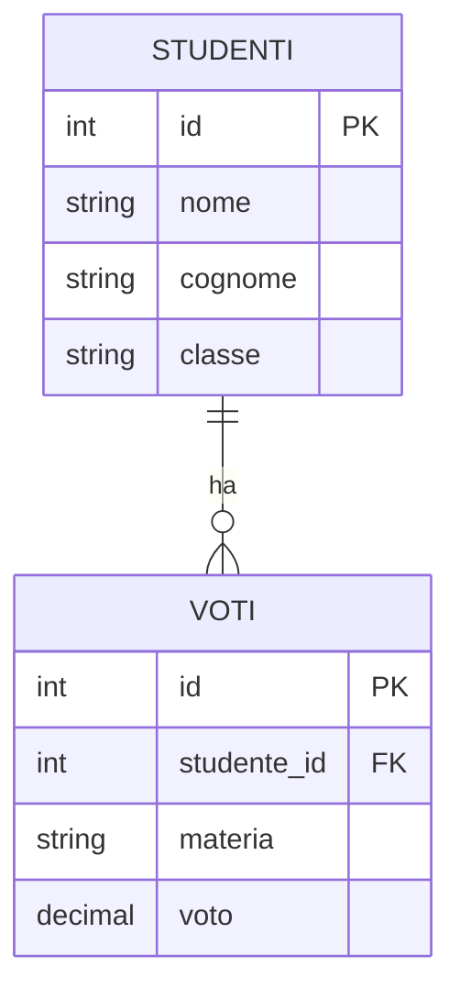
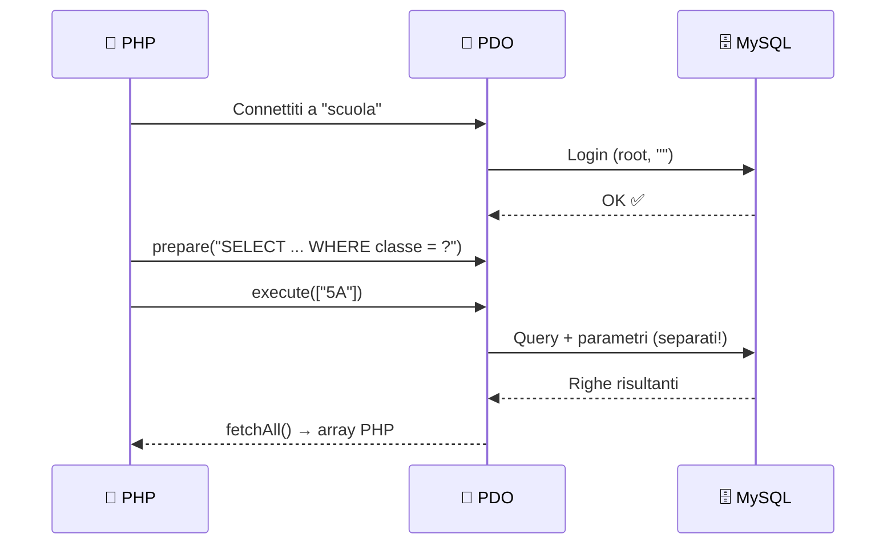
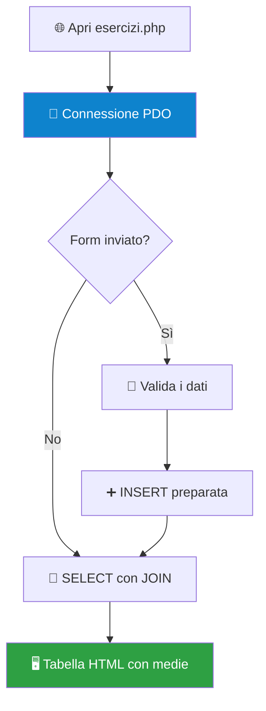

# 🗄️ Modulo 04: Database MySQL — La Memoria del Tuo Sito

> Pensa a **Netflix** 🍿: come fa a ricordarsi cosa stavi guardando, a che minuto ti sei fermato e che hai visto 4 volte la stessa serie in una settimana? Non lo ricorda *lui*: lo scrive in un **database**. Finora i dati dei nostri script morivano appena la pagina si chiudeva, come un pesce rosso 🐟. Oggi diamo al nostro sito una **memoria vera**.

---

## 🧠 Concetti chiave

- **Database** = archivio organizzato di dati. **MySQL** è il sistema che lo gestisce.
- Un database è fatto di **tabelle**, le tabelle di **righe** (record) e **colonne** (campi).
- **SQL** = il linguaggio con cui "parliamo" al database.
- **PDO** = il ponte 🌉 tra PHP e MySQL.

> [!NOTE]
> Pensa a un database come a un **foglio Excel super-potenziato**: ogni tabella è un foglio, ogni riga un elemento, ogni colonna una proprietà. Solo che è molto più veloce, sicuro e capace di collegare i fogli tra loro.

---

## 📊 Anatomia di una tabella

Tabella `studenti`:

| id 🔑 | nome | cognome | classe |
|:--:|------|---------|:------:|
| 1 | Sofia | Rossi | 5A |
| 2 | Marco | Bianchi | 5A |
| 3 | Giulia | Verdi | 5B |

- **`id`** è la **chiave primaria** (*PRIMARY KEY*): identifica ogni riga in modo **unico**, come il codice fiscale.

Tabella `voti` (collegata a `studenti` tramite **chiave esterna**):

| id | studente_id 🔗 | materia | voto |
|:--:|:--:|---------|:--:|
| 1 | 1 | Informatica | 9 |
| 2 | 1 | Matematica | 7 |
| 3 | 2 | Informatica | 6 |



> [!TIP]
> Leggi il simbolo `||--o{` così: **un** studente può avere **zero o molti** voti. Ogni voto appartiene a **un solo** studente.

---

## 🚀 Preparare il terreno in Laragon

1. Avvia Laragon (**Avvia tutto**).
2. Apri **HeidiSQL** con il pulsante **Database**. Credenziali di default di Laragon: utente `root`, password **vuota**.
3. Crea il database ed esegui lo script `schema.sql` di questa cartella (menu *File → Carica file SQL*, poi ▶️ Esegui).

> [!WARNING]
> `root` senza password va **benissimo** sul tuo PC di studio. Su un server vero sarebbe un disastro: lì si creano utenti dedicati con password robuste e permessi limitati.

---

## 🗣️ SQL: le 4 parole magiche (CRUD)

| Operazione | Comando SQL | Significato | Esempio |
|:--:|:--:|-------------|---------|
| **C**reate | `INSERT` | Aggiungi una riga | `INSERT INTO studenti (nome, cognome, classe) VALUES ('Anna','Neri','5C');` |
| **R**ead | `SELECT` | Leggi dati | `SELECT * FROM studenti WHERE classe = '5A';` |
| **U**pdate | `UPDATE` | Modifica righe | `UPDATE studenti SET classe = '5B' WHERE id = 2;` |
| **D**elete | `DELETE` | Elimina righe | `DELETE FROM studenti WHERE id = 3;` |

> [!CAUTION]
> 💣 **`UPDATE` e `DELETE` senza `WHERE` agiscono su TUTTE le righe!** `DELETE FROM studenti;` cancella l'intera tabella. Scrivi sempre prima la clausola `WHERE`.

Un assaggio di **JOIN** (unire due tabelle) e di funzioni di aggregazione:

```sql
-- Media voti di ogni studente, dal più bravo al meno bravo
SELECT s.nome, s.cognome, ROUND(AVG(v.voto), 2) AS media
FROM studenti AS s
JOIN voti AS v ON v.studente_id = s.id   -- collega voto ↔ studente
GROUP BY s.id                            -- una riga per studente
ORDER BY media DESC;                     -- ordina dalla media più alta
```

---

## 🌉 PHP ↔ MySQL con PDO



```php
<?php
// 1️⃣ Dati di connessione (DSN = "indirizzo" del database)
$dsn  = "mysql:host=localhost;dbname=scuola;charset=utf8mb4";

try {
    // 2️⃣ Creiamo la connessione PDO
    $pdo = new PDO($dsn, "root", "", [
        PDO::ATTR_ERRMODE            => PDO::ERRMODE_EXCEPTION,   // errori come eccezioni (si vedono!)
        PDO::ATTR_DEFAULT_FETCH_MODE => PDO::FETCH_ASSOC,         // risultati come array associativi
    ]);

    // 3️⃣ Query PREPARATA: il ? è un segnaposto
    $stmt = $pdo->prepare("SELECT nome, cognome FROM studenti WHERE classe = ?");

    // 4️⃣ La eseguiamo passando il valore a parte
    $stmt->execute(["5A"]);

    // 5️⃣ Leggiamo tutte le righe e le stampiamo
    foreach ($stmt->fetchAll() as $riga) {
        echo htmlspecialchars($riga['nome'] . " " . $riga['cognome']) . "<br>";
    }

} catch (PDOException $ex) {
    // Se qualcosa va storto, lo diciamo (solo in fase di studio!)
    echo "💥 Errore: " . htmlspecialchars($ex->getMessage());
}
?>
```

---

## 🦹 Il boss finale: SQL Injection

Immagina un login scritto così 😱:

```php
// ❌ MAI, MAI, MAI
$sql = "SELECT * FROM utenti WHERE nome = '$nome' AND password = '$pass'";
```

Se l'utente scrive come nome: `' OR '1'='1' -- ` la query diventa **sempre vera** e il cattivo entra senza password. Questo è l'attacco **SQL Injection**, uno dei più celebri (e dannosi) della storia del web.

**La difesa è semplice: query preparate.** I valori viaggiano **separati** dalla query, quindi il database li tratta sempre come *dati*, mai come *comandi*:

```php
// ✅ SEMPRE
$stmt = $pdo->prepare("SELECT * FROM utenti WHERE nome = ? AND password = ?");
$stmt->execute([$nome, $pass]);
```

> [!IMPORTANT]
> 🔐 **Regola di vita:** mai concatenare variabili dell'utente dentro una stringa SQL. Sempre `prepare()` + `execute()`.
>
> (E le password vere non si salvano in chiaro: si usano `password_hash()` e `password_verify()`, ma ne parleremo in un altro modulo.)

---

## 🎮 La Missione Finale: *"Il Registro Elettronico"*

Apri `esercizi.php` e costruisci il tuo **mini-registro elettronico** collegando i moduli 01, 03 e 04.

> **Brief della missione:**
>
> 1. Esegui `schema.sql` in HeidiSQL per creare database `scuola` e tabelle con dati di prova
> 2. **READ:** stampa in una tabella HTML l'elenco di tutti gli studenti con la loro **media voti**
> 3. **CREATE:** aggiungi un form per inserire un nuovo studente (riusa quello che hai imparato nel Modulo 03: validazione ed escaping!)
> 4. Filtra l'elenco per **classe** con un parametro `GET` (`?classe=5A`)
> 5. 🔥 **Bonus:** aggiungi un pulsante **Elimina** accanto a ogni studente (usa **POST**, non GET!, e query preparate)



> [!NOTE]
> **Come consegnare:** `git commit -m "modulo-04: registro elettronico completato"` e apri una Pull Request. Non committare mai password reali di database: i dati di connessione veri vanno in un file escluso da Git (guarda il `.gitignore`!). 🙈

---

## 🏁 Congratulazioni!

Hai attraversato tutti i livelli: **server locale ✅ linguaggio ✅ form ✅ database ✅**. Sai costruire le fondamenta di un vero sito dinamico. I prossimi boss da sconfiggere? **Sessioni e login**, **hashing delle password**, **architettura MVC** e **framework** come Laravel. 🚀

⬅️ Torna all'[indice del corso](../README.md)
